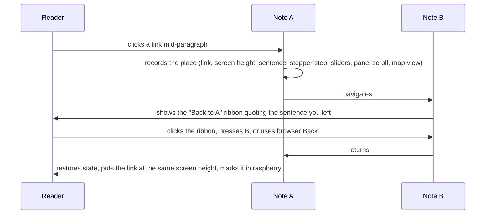

# Principles

These describe what reading this notebook should feel like. They outrank convenience: if a change to code or content conflicts with a principle, the principle wins. Each one has an id that checks, tests and agent hooks cite when something breaks, so an error like `[keep-place]` points here.

Changing a principle is the owner's call. Agents propose; they don't edit this file on their own.

| id | In one line | Enforced by |
| --- | --- | --- |
| `keep-place` | Following a link is a detour, not a move. You can always get back to the exact spot. | `scripts/checks/site.mjs`, `scripts/test-place.mjs` |
| `visual-first` | Show the idea before explaining it. | `scripts/checks/visual.mjs` |
| `one-idea` | Each idea is explained once, in its own note; everything else links to it. | review, `AGENTS.md` rules |
| `sourced-numbers` | A number without a source isn't shown. Status says how far to trust a note. | `scripts/checks/sources.mjs` |

---

## keep-place

**Following a link is a detour, not a move.** A reader who jumps to another idea can always get back to the exact spot they left: the same page, the same sentence at the same height on screen, the same step of a stepper, the same slider values, the same view of the map.

Learning here is depth-first. You read about MLA, hit "RoPE", follow it, maybe follow one more link, then want to continue where you were. If coming back means scrolling around to find your sentence, every link becomes a small penalty for being curious. So the site remembers your place for you.

### What the reader gets

- A **ribbon** in the bottom-left corner: "Back to *Multi-head latent attention*, in *Why RoPE needs a side channel*", with the sentence around the link and the link itself highlighted.
- **Several hops deep** works like a stack. The dots next to the ribbon open the whole trail, newest first, and any stop can be jumped to.
- The **`B` key** and the **browser's Back button** do the same thing as the ribbon.
- On return the link gets a raspberry wash that fades, plus a notch in the margin, so your eye lands on it. Raspberry (`--place`) means "your place" and nothing else; diagrams never use it.

### The contract for code

Anything that changes navigation, layout or interactivity must keep these true:

1. **Every page renders inside `layouts/Base.astro`**, which mounts the ribbon (`#trail`) and calls `initTrail()`.
2. **Every interactive component is restorable.** Its element has `data-restorable` and implements `snapshot()` (JSON-serialisable state, or `null`) and `restore(state)`. If it builds its links asynchronously it also implements `whenReady()`. See `Stepper.astro` for the smallest example and `GlobalGraph.astro` for an async one. A component with genuinely no state says so in a comment: `restorable: none, <reason>`.
3. **Independently scrolling panels carry `data-keep-scroll`.**
4. **Navigation goes through real `<a href>` links.** The trail listens for link clicks; a `location.href = ...` in a click handler is invisible to it.
5. **Layout is reproducible.** The same page should lay out the same way on every load. Anything that shifts after load (fonts, async diagrams) must settle within about 1.5 s, which is how long the trail keeps re-aligning.

The implementation is `src/scripts/trail.ts`. `scripts/checks/site.mjs` checks points 1 and 2 statically. `scripts/test-place.mjs` drives a real browser through the whole round trip, both with the back/forward cache and with full reloads, and fails if the link lands more than 4 px from where it was.

---

## visual-first

**Show the idea before explaining it.** Each main idea in a note gets a picture, and the picture comes before the equation and before the long paragraph. A reader skimming only the visuals should still get the shape of the idea.

- Pick the visual by the question it answers: `<ArchDiagram>` for "what connects to what", `<Calc>` for "how does this scale", `<Stepper>` for "what happens, in order".
- Colours mean the same thing everywhere (activation, weight, cache, route, op), so a reader learns them once.
- A written concept or system note without a visual fails the check. More than about 650 words of prose between two visuals gets a warning: split the idea or draw the key step.
- Agents check their visuals by looking at them: `pnpm run shot /notes/<slug>/` writes a screenshot to `.scratch/shots/`. Open it before finishing.

---

## one-idea

**Each idea is explained once.** A concept note explains one reusable idea. A system note explains what a model combines and what is new, and links to the concepts it reuses instead of re-explaining them. The graph of links is the table of contents. The detailed rule is `one-idea` in `AGENTS.md`.

## sourced-numbers

**A number without a source isn't shown.** Every architecture number comes from a paper, a report or a `config.json`, and is cited where it appears. A note's status (stub, draft, reviewed, verified) tells the reader how much to trust it, and only the owner moves a note past draft. The detailed rules are `sourced-numbers` and `agent-status` in `AGENTS.md`.
