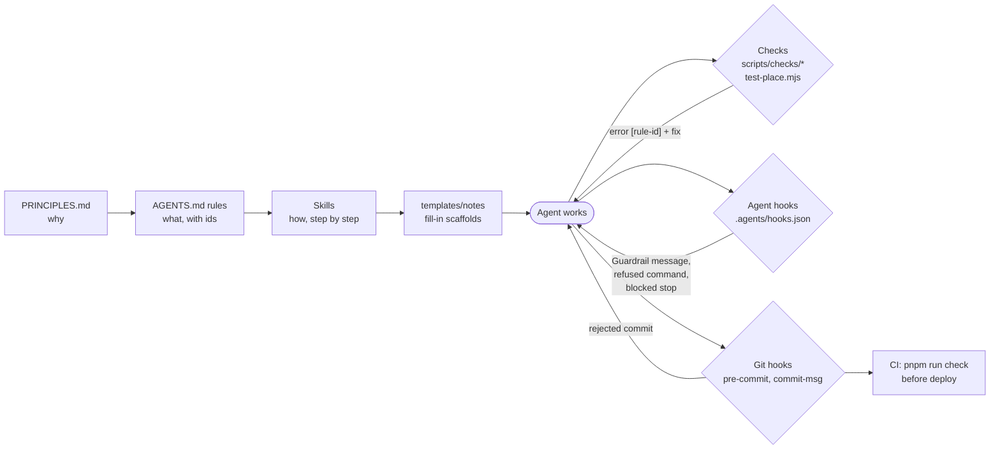

# Guardrails: how this repo keeps agents on the rails

Most content here is written by agents. The guardrails make sure an agent that drifts finds out quickly and is told exactly which rule it broke, without anyone watching. This document is for whoever extends the system, human or agent.

## The loop



Every message the system sends back names a rule id from `scripts/rules.mjs`, and every id is documented in `AGENTS.md` or `PRINCIPLES.md`. That is the self-correction: the agent is pointed to the exact text it ignored.

## The layers

| Layer | Where | When it acts | What it does |
| --- | --- | --- | --- |
| Principles | `PRINCIPLES.md` | read at start | The reader experience the rules protect. |
| Rules | `AGENTS.md` | always loaded | Numbered rules with ids, lifecycle, commands. |
| Skills | `.agents/skills/*/SKILL.md` | per task | Step-by-step workflows: `write-article`, `site-feature`, `finish-task`. |
| Templates | `templates/notes/` | new note | `pnpm run new <kind> <slug> "Title" --draft`; `{/* TODO */}` prompts fail the check until replaced. |
| Checks | `scripts/check.mjs` + `scripts/checks/*.mjs` | `pnpm run check`, hooks | Static rules over notes, sources, components and docs. |
| Behaviour test | `scripts/test-place.mjs` | `pnpm run check` | Drives Chrome through a link round trip in bfcache and reload modes. |
| Render test | `scripts/test-visual.mjs` | `pnpm run check` | Loads every page at 1280, 390 and 2560 px and inspects the real rendering (overflow, clipped or colliding text, KaTeX and script errors). |
| Baseline | `scripts/baseline.json` | every check | Grandfathers problems that predate a rule (by file and code) as warnings, so a new rule can be strict without editing other people's files. Only shrinks. |
| Agent hooks | `.agents/hooks.json` and `.claude/settings.json` (via `scripts/agent-hooks/claude.mjs`), `scripts/agent-hooks/` | session start, every turn, every command, stop | Orient, notify, refuse, gate. |
| Git hooks | `.githooks/` (installed by `pnpm install`) | every commit | Scoped checks on staged files, then `scripts/check-commit.mjs` checks the commit tree itself in a temp checkout (catches links to uncommitted notes that pass locally and fail in CI); commit message format. |
| CI | `.github/workflows/deploy.yml` | push to main | `pnpm run check` before deploy. |
| PR check | `.github/workflows/check.yml` | pull request to main | the same `pnpm run check`, no deploy. |

### Agent hooks in detail

| Hook | Event | Behaviour |
| --- | --- | --- |
| `orient` | `SessionStart` | Snapshots which files are already dirty (so later hooks can tell your work from others'), then injects the check status and the list of files that aren't yours. |
| `guardrail-notify` | `PreInvocation` | Runs the checks scoped to files you changed this session; if any fail, or a note was promoted past `draft`, injects a transient "Guardrail:" message before your next turn. Silent when clean. |
| `git-safety` | `PreToolUse` on `run_command` | Refuses `git add -A/./-u`, `commit -a`, `--no-verify`, `stash`, `reset --hard`, `clean -f`, `checkout .`, `restore .`, `push --force`, `config --global`, and overriding `core.hooksPath`. No opinion on anything else. |
| `definition-of-done` | `Stop` | Blocks stopping if your files fail checks, a note was promoted, `pnpm run check` hasn't run since your last edit, or your files are uncommitted. Each distinct problem set is raised once, so an agent that is deliberately pausing can stop on the second try. |

### Claude Code

Claude Code reads `.claude/settings.json`, not `.agents/hooks.json`. `scripts/agent-hooks/claude.mjs <event>` adapts its payloads (and its transcript format) to the same hook scripts, so both harnesses share one implementation:

| Claude Code event | Adapter event | Hook |
| --- | --- | --- |
| `SessionStart` | `session-start` | `orient` (also points at `tail -n 40 worklog.md`) |
| `PostToolUse` on Write/Edit/MultiEdit/NotebookEdit, `UserPromptSubmit` | `guardrail` | `guardrail-notify`, injected as additional context |
| `PreToolUse` on Bash | `pre-tool-use` | `git-safety`, as a permission deny |
| `Stop` | `stop` | `definition-of-done`, as a block with the reason |

Shell commands that write files (redirects, `sed -i`, scripts) count as edits for the "check ran after your last edit" rule. Test by hand: `echo '{"session_id":"t","tool_input":{"command":"git add -A"}}' | node scripts/agent-hooks/claude.mjs pre-tool-use`.

"Files you changed" means files that differ from the session-start snapshot, plus files the transcript shows you writing. Hooks fail open: an internal error is logged to `.agents/.state/hook-errors.log` and the agent keeps working.

## Adding a rule

When you find a new way for work to go wrong, make the system catch it:

1. **Register it** in `scripts/rules.mjs`: an id, a one-line title, and the doc anchor where it's explained.
2. **Document it** at that anchor: a numbered rule in `AGENTS.md#rules`, or a principle section in `PRINCIPLES.md`. The `catalog-sync` check fails until the id appears there in backticks.
3. **Enforce it** in the cheapest layer that can see it:
   - Visible in the files? Add a module to `scripts/checks/` (below). It then runs in `pnpm run check`, the pre-commit hook and the agent hooks for free.
   - Only visible at runtime in the browser? Add a case to `scripts/test-place.mjs` or a new test script wired into `pnpm run check`.
   - About a command or the agent's process? Extend `scripts/agent-hooks/pre-tool-use.mjs` or `stop.mjs`.
4. **Give a fix**, not just a complaint: every `error()` takes a `fix` string that says what to do.
5. **Mention it in the skill** where the mistake happens, so agents avoid it before the check fires.

### A check module

```js
// scripts/checks/my-rule.mjs. Loaded automatically, in filename order.
export default function myRule(ctx, { error, warn }) {
  // ctx: { root, notes, sources, bySlug, sourceIds, read(rel), exists(rel), list(dir, ext) }
  // note: { slug, file, dir, data (frontmatter), body, bodyLine, wikilinks }
  for (const n of ctx.notes) {
    if (bad(n)) error('my-rule', n.file, 'what is wrong', 'what to do about it');
  }
}
```

Use `error` for things that must not ship and `warn` for nudges. Report against the file the author has to edit, because `--files`/`--staged` scoping (pre-commit, hooks) decides by that path whether an error blocks.

## Debugging hooks

Hooks read JSON on stdin and print JSON on stdout, so you can run them by hand:

```sh
echo '{"toolCall":{"name":"run_command","args":{"CommandLine":"git add -A"}}}' | node scripts/agent-hooks/pre-tool-use.mjs
echo '{"conversationId":"t","transcriptPath":"<path to transcript.jsonl>","terminationReason":"NO_TOOL_CALL"}' | node scripts/agent-hooks/stop.mjs
node scripts/check.mjs --json --files src/content/notes/concepts/mla.mdx
```

Per-conversation state lives in `.agents/.state/` (gitignored). Delete it to reset the stop hook's "already reminded" memory.
