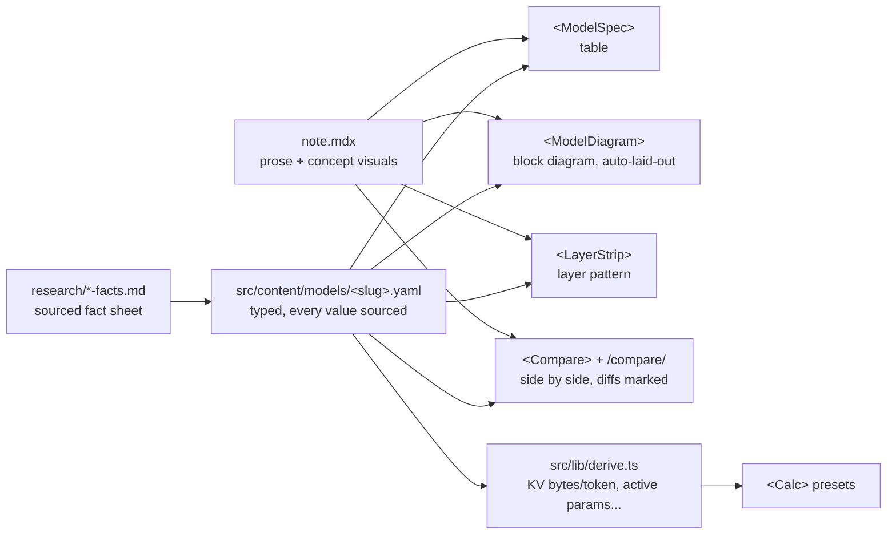

# Visual system: design and roadmap

Status: **implemented** (all phases done 2026-10-17; see the roadmap table for what each shipped and what is still baselined). The component catalog in `AGENTS.md#components` is the reference for authors; this file explains why the system is built this way.

The goal: a reader understands a note by looking at it, diagrams never have layout bugs, and any two models can be compared side by side. The way to get there is to **move work from the author to the system**. An agent should write facts and prose; layout, colours, numbers in pictures and comparisons should be derived and checked automatically.

## What goes wrong today, and why

| Symptom | Root cause | Fix in this plan |
| --- | --- | --- |
| Overlapping blocks, edges through blocks, cramped labels | `<ArchDiagram>` blocks are placed by hand (`col`, `row`); labels aren't measured | Geometry lint (phase 1), auto-layout (phase 3) |
| Wrong numbers in diagrams | `sub: '7168'` is free text, outside `sourced-numbers` | Numbers come from model data, never typed into a diagram (phases 1, 2) |
| Same number typed twice (diagram, Spec, prose) and drifting apart | No single place a model's numbers live | `src/content/models/*.yaml` (phase 2) |
| Can't compare models | Every `<Spec>` uses its own row labels | A fixed field vocabulary (phase 2) |
| Walls of text | Only one soft rule (650 words between visuals, warning) | Tighter, per-section structure rules (phase 5) |
| Bugs only visible in the browser (fonts, wrapping, mobile width) | Nothing inspects the rendered page except a screenshot the agent may not open | Browser visual test (phase 4) |

## The architecture: facts are data, pictures are derived



The agent writes three things: the fact sheet, the model YAML, and the prose. Everything in the middle column is generated, so it is aligned, coloured and sourced by construction.

### Model data (phase 2)

One file per model in a new `models` content collection, validated by Zod in `src/content.config.ts`:

```yaml
# src/content/models/deepseek-v3.yaml
note: deepseek-v3                 # the system note this backs
extends: deepseek-v2              # inherit, override only what changed
params_total: { v: 671e9,  source: deepseek-v3-report, where: "§1" }
params_active: { v: 37e9,  source: deepseek-v3-report, where: "§1" }
layers:       { v: 61,     source: deepseek-v3-config, where: "num_hidden_layers" }
hidden_size:  { v: 7168,   source: deepseek-v3-config, where: "hidden_size" }
attention:
  type: mla                       # must be a concept note slug
  heads: { v: 128, source: deepseek-v3-config, where: "num_attention_heads" }
ffn:
  type: moe
  routed_experts: { v: 256, source: ..., where: ... }
  active_experts: { v: 8,   source: ..., where: ... }
  shared_experts: { v: 1,   source: ..., where: ... }
  dense_layers:   { v: 3,   source: ..., where: "first_k_dense_replace" }
pattern: "D3 E58"                 # layer pattern: 3 dense, 58 MoE (hybrids: "M M M* ...")
```

- **The field vocabulary is fixed** in `src/lib/fields.ts`: key, label, unit, formatter, and the concept note that explains it. A new field is added there once, not invented per note. This is what makes comparison possible.
- **Every leaf number is `{ v, source, where }`.** The schema rejects a bare number, so `sourced-numbers` holds by construction. A value with no primary source is simply left out.
- **`extends`** lets a model state only its differences. `<ModelSpec>` can then render "what changed vs the parent" automatically, which is exactly what a system note should be about (`one-idea`).
- **Type fields** (`attention.type`, `ffn.type`) must be note slugs, so the diagram can link each block to its concept.
- **Derived numbers** (KV cache bytes per token, active-parameter ratio) are computed in `src/lib/derive.ts` with the formula shown on hover, and list the sources of their inputs. They are never typed by hand.

### Components built on the data

| Component | Shows | Replaces |
| --- | --- | --- |
| `<ModelSpec model="x" [diff]>` | Spec table from the YAML; `diff` shows only fields changed vs `extends` | hand-written `<Spec>` in system notes |
| `<ModelDiagram model="x">` | The layer block, generated from `attention.type` / `ffn.type` templates, numbers filled from data | hand-placed system `<ArchDiagram>` |
| `<LayerStrip model="x">` | One cell per layer, coloured by layer type; essential for hybrids (Nemotron, LFM2.5) | prose describing the pattern |
| `<Compare models={["a","b"]} [fields]>` | Fields side by side, differing cells highlighted, derived rows included | ad-hoc comparison paragraphs |
| `/compare/?m=a,b,c` page | Pick any models; state in the URL so links and the return trail work | nothing |

`/compare/` is an interactive page, so it must be restorable (`keep-place`): model selection lives in the URL and in `snapshot()`/`restore()`, and model names are real `<a href>` links.

### Concept diagrams stay hand-authored, but checked

Concepts (MLA, KV cache, flow matching) need custom pictures, so `<ArchDiagram>` stays. It gets safer in two steps:

1. **Lint (phase 1, done).** `src/lib/diagram/geometry.mjs` holds both the layout the component renders with and `lintDiagram()`. `scripts/checks/diagram.mjs` reads props straight out of the MDX (they are literals; `scripts/lib/mdx-props.mjs` evaluates them without compiling), so the per-turn guardrail hook catches mistakes in under a second. Rule id: `diagram-geometry`. Label widths use glyph metrics measured from the real fonts (`src/lib/diagram/metrics.mjs`).
   - two blocks in overlapping cells;
   - an edge segment passing through a block it doesn't connect;
   - two edges sharing a segment (e.g. two `side: 'left'` edges over the same rows);
   - a label wider than its box, measured with real font metrics for IBM Plex Sans (precomputed glyph widths in a JSON table);
   - more columns than fit the reading column (about 4 at 150 px);
   - a digit in `label` or `sub` (numbers belong in model data or a `<Spec>`; allow-list shapes like `n × d_c`);
   - a block `role` outside the five roles, or `link` to a stub when a written note exists under another slug.
2. **Auto-layout (phase 3, done).** `col`/`row` are optional. Without them, blocks are placed at build time on the same grid: rows by longest path from the inputs, columns by the mean column of their parents, siblings spread around them. Edges try several orthogonal routes and keep one that crosses no block. Columns widen to fit measured labels. Build-time layout keeps the page identical on every load (`keep-place` point 5) and costs the reader nothing. Hand coordinates remain as an override.

### Visual vocabulary to add

Pictures should match the question. New components worth building, each restorable and using only the role colours:

| Component | Answers |
| --- | --- |
| `<ShapeFlow>` | "What shape is the tensor at each step?" Shape chips along a path, the dimension that changes highlighted. |
| `<MaskGrid>` | "Which tokens can attend to which?" Causal, sliding window, sparse (DSA) masks as small grids, steppable. |
| `<LayerStrip>` | "How are layer types interleaved?" (above) |
| `<Compare>` | "How does this differ from that?" (above) |
| `<Timeline>` | "What came before what?" For lineage paths; nodes are note links. |

Each one also needs a lint function and a row in the `AGENTS.md` catalog (`catalog-sync` enforces the row).

### Design tokens

All colours, spacing and type sizes for visuals live in one stylesheet of CSS variables (role colours, `--place`, grid unit, label size). Components accept roles, never raw colours. A check greps `src/components/viz/` for hex colours outside the token file.

## Catching mistakes automatically

Cheapest layer first (see `docs/guardrails.md#adding-a-rule`):

| Layer | Catches | Speed |
| --- | --- | --- |
| Zod schema (models collection) | missing source, bare number, unknown field, wrong type slug | at build, and in `check:graph` |
| `check:graph` + `diagram-geometry` | overlaps, crossings, overflow, digits in diagrams, too wide | < 1 s, every turn via the guardrail hook |
| `visual-first` structure rules | walls of text, sections without visuals, visual after its prose | < 1 s |
| Browser visual test `scripts/test-visual.mjs` | real rendering: text overflowing its rect (`getBBox`), overlapping elements, horizontal scroll at 390 px, KaTeX errors, console errors | seconds, in `pnpm run check` |
| Screenshot diff | unintended visual change to a page the task didn't touch | seconds, optional |

Every message names a rule id and a `fix:` line, so the agent is pointed to the text it broke.

## Fewer walls of text (phase 5)

Tighten `scripts/checks/visual.mjs`, warnings first, errors once existing notes are migrated:

- the first visual comes within the first ~120 words of the body;
- every `##` section of a concept or system note contains a visual, `<ModelSpec>`, `<Compare>` or `<Spec>`;
- at most ~250 words of prose between visuals (now 650);
- paragraphs over ~90 words get a warning;
- more than two `<Callout>`s per note gets a warning;
- a system note starts with its model card: `<ModelDiagram>`, `<LayerStrip>`, `<ModelSpec diff>`.

Update `templates/notes/system.mdx` to that shape so a new note starts compliant.

## Roadmap

Each phase ends with `pnpm run check` passing and existing notes migrated or explicitly allow-listed.

| Phase | Deliverable | Done when |
| --- | --- | --- |
| 0 | This doc, `docs/workflow.md`, `worklog.md`, `CLAUDE.md` symlink | done 2026-10-17 |
| 1 | `diagram-geometry` lint in `check:graph` sharing the component's layout code; obstacle-avoiding edge router, residual lanes, auto column width; `scripts/baseline.json` ratchet; `shot --select` | done 2026-10-17 |
| 2 | `models` collection, `src/lib/models/fields.mjs`, `<ModelSpec>` (+ `diff`), `<Compare>`, `/compare/`, layer pattern strips; DeepSeek V2/V3/V3.2 and LFM2.5 migrated | done 2026-10-17; Nemotron and StableHand wait for their uncommitted drafts |
| 3 | Automatic placement (longest-path rows, parent-mean columns; chosen over ELK to stay on the grid the lint checks and add no dependency), groups by block id, `<ModelDiagram>`, `<LayerStrip>` | done 2026-10-17 |
| 4 | `scripts/test-visual.mjs` (rule `render-clean`) in `pnpm run check`, with `--selftest` | done 2026-10-17: every page at 1280 and 390 px, about 40 s |
| 5 | Structure rules (errors for new work, existing violations in `scripts/baseline.json`), model-card system template, MHA migrated | done 2026-10-17; baseline lists the remaining notes to migrate |
| 6 | Claude Code hooks through `.claude/settings.json` + `scripts/agent-hooks/claude.mjs` adapter; pre-commit checks the commit tree in a clean checkout | done 2026-10-17 |
| 7 | `<ShapeFlow>` (MLA), `<MaskGrid>` (MHA, hybrid conv-attention), `<Timeline>` (both lineage paths), props lint in `scripts/checks/viz-props.mjs` | done 2026-10-17 |

What's left is content, not machinery: model data for Nemotron and StableHand once their drafts are committed, DeepSeek-V4/V4.1 data, and migrating the notes listed in `scripts/baseline.json`.
