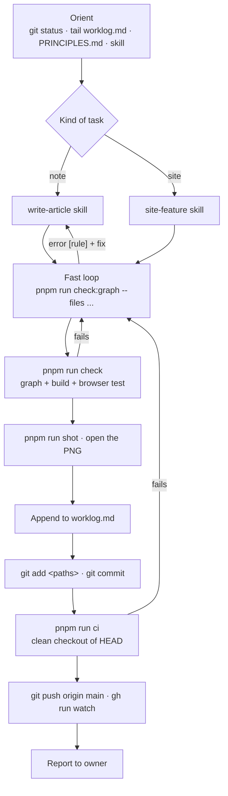

# Workflow

How work moves through this repo, for the owner and for agents. Rules live in `AGENTS.md`, reasons in `PRINCIPLES.md`, the plan for visuals in `docs/visual-system.md`.

## Who does what

| Owner | Agent | System |
| --- | --- | --- |
| Picks topics, reviews notes, promotes status past `draft`, edits `PRINCIPLES.md` | Gathers sources, writes facts and prose, draws concept visuals, fixes what checks report | Validates, lays out, colours, derives numbers, compares models, blocks bad commits |

The agent should spend its effort on content. If an agent keeps making the same mistake, the fix is a new check (`docs/guardrails.md#adding-a-rule`), not a longer instruction.

## One task, end to end



## Writing a model (system) note

1. **Facts.** Check `research/` for a fact sheet. If none, write `research/<family>-facts.md`: every number with source id and section or config key.
2. **Sources.** One YAML per source in `src/content/sources/`.
3. **Model data.** Write `src/content/models/<slug>.yaml` with keys from `src/lib/models/fields.mjs`; `extends` the parent model and state only what you sourced; every value is `{ v, source, where }` (add `display` when the source writes it differently, e.g. `128K`). Layer patterns use sublayer codes (`AD*3 AE*58`, `CD*2 AD ...`); the check verifies the count against `layers`. Show it in the note with `<ModelSpec model="<slug>" />`, and `<ModelSpec model="<slug>" diff />` for what changed from the parent.
   Fill the architecture fields too (`tokenizer`, `tie_embeddings`, `norm`, `qk_norm` or `latent_norm`, `ffn_activation`, router fields for MoE): `<ModelOverview>` draws the whole model from them, and the check lints every generated view.
4. **Tokenizer.** Point `tokenizer:` at a file in `src/content/tokenizers/` (see [Tokenizers](#tokenizers)); if the model brings a new one, add it.
5. **Stubs.** `pnpm run new concept <slug> "Title"` for each missing concept, with a real summary.
6. **Note.** `pnpm run new system <slug> "Title" --draft`. Open with `<ModelOverview model="<slug>" />`, then the numbers, then one section per thing that is new, each with its visual before its prose, and a `## Tokenizer` section with `<Tokenizer model="<slug>" />` (rule `model-card`). Link everything reused.
7. **Fast check** after each edit: `pnpm run check:graph --files <your files>`.
8. Finish with `.agents/skills/finish-task/SKILL.md`.

## Papers that aren't language models

Not every paper is text in, next token out. A video-to-motion model, a diffusion pipeline or a robot policy is a chain of stages around one trained backbone. Describe it with the same data, as `kind: pipeline` (StableHand is the worked example: `src/content/models/stablehand.yaml`).

1. **Sort the paper's parts** in the fact sheet before writing anything: what it reuses (link to the concept note, or stub one), what is new and reusable (its own concept note, rule `one-idea`), and what only this system does (its system note).
2. **Model data** with `kind: pipeline` and a `stages:` list from input to output. Each stage has `id`, `label`, `role` (the diagram roles), `from:` (the stages feeding it, optionally `{ id, label, side }`), `source` and `where`; `frozen: true` marks an off-the-shelf model used as is, `link:` a note, and `col`/`row` place it when automatic placement tangles the edges. Exactly one stage has `backbone: true`.
3. **Backbone numbers** use the ordinary fields (`layers`, `hidden_size`, `attention`, `heads`, `ffn_hidden`, `ffn_activation`) and a `layer_pattern` listing each block's sublayers in order: `AXD*8` is self-attention, cross-attention, FFN, eight times. Set `causal: false` when attention sees the whole sample (no cache), and fill the input and output fields (`input`, `output`, `seq_unit`, `seq_length`, `tokens_per_step`, `output_dim`) and the sampling fields (`objective`, `sampler`, `sampling_steps`, `modulation`, `modulation_from`, `cross_inputs`) that apply.
4. **Note.** `<ModelOverview>` draws the stages, one backbone block and each sublayer from the data; `<ModelSpec>` shows the numbers; `<ModelDiagram>` draws one block where a section needs it. No tokenizer section (rule `model-card` asks for one only for `kind: lm`). Numbers that are not model fields (training budget, benchmark tables) stay in `<Spec>`.
5. **Missing pieces.** If the backbone has a sublayer the generator can't draw yet, add it to `SUBLAYERS` in `src/lib/models/fields.mjs` and a view in `src/lib/models/overview.mjs` rather than hand-drawing the model.

## Tokenizers

A tokenizer is shared by every model that uses it, so it is described once:

1. **Files.** Add the model repo's tokenizer files as a source (`type: config`, url to the repo tree).
2. **Data.** `src/content/tokenizers/<id>.yaml` with keys from `src/lib/tokenizers/fields.mjs`. Counts come from `tokenizer.json` (`where:` the JSON path); what it was trained for comes from the report. List the pre-tokenizer rules in plain words with their regex, and the named special tokens with ids.
3. **Samples.** Add the repo to `TOKENIZERS` in `scripts/tokenizer-samples.py` and run `python3 scripts/tokenizer-samples.py` (needs `pip install tokenizers jinja2`). It writes `src/data/tokenizer-samples.json`: each sample text split stage by stage, the chat format rendered, and vocabulary overlap with a predecessor. Never edit that file by hand.
4. **Note.** One system note per tokenizer (`note:` in the data) with `<TokenizerFlow>`, `<Tokenizer id="<id>" full />` and, when it replaced another, `<TokenizerCompare>`. Models link to it through their `<Tokenizer model=...>` card.

## Writing a concept note

Same as above without model data. Plan two to four visuals before writing (`<ArchDiagram>` structure, `<Calc>` scaling, `<Stepper>` procedure), then write the prose around them. Draw with symbols and give every tensor its shape (`T × d`, `d → d_c`); numbers go in prose or a `<Spec>`, never in the boxes. Conventions and the shared symbol table: [AGENTS.md#style](../AGENTS.md#style).

## Comparing models

- In a note: `<Compare models={["deepseek-v3", "nemotron-3-super"]} />`.
- Ad hoc: `/compare/?m=deepseek-v3,nemotron-3-super`.
- A field missing from a model shows as "not reported" rather than a guess.
- Derived rows (head dim, attention layers, KV cache per token and at full context, active share) are computed in `src/lib/models/data.mjs` from sourced values; hover shows the formula. Never type a derived number by hand.

## Keeping costs down

Agent context is the expensive part. Defaults:

- **Worklog:** `tail -n 40 worklog.md` only. Never open the whole file. Newest entries are at the bottom; read upward and stop once you have the context you need. To find an older topic: `grep -n "<term>" worklog.md | tail -n 5`, then `sed -n '<from>,<to>p' worklog.md`.
- **Large files:** read by line range (`sed -n`, or Read with offset/limit), not whole.
- **Checks:** iterate with `check:graph --files ...` (under a second); run the full `pnpm run check` once at the end.
- **Search before reading:** `rg -l "<term>" src/content/notes` to find the note, then read only that note.
- **Fact sheets** in `research/` exist so the next agent doesn't redo the web search. Write one for any topic that took real searching.
- **Screenshots:** one `--full` shot per changed note, plus `--width 390` only when layout changed.

## The worklog

`worklog.md` is an append-only log at the repo root, one entry per finished task, newest at the bottom. It's how the next agent learns what just happened without reading git history or the whole file.

Append with the shell, right before committing (works in bash and fish), and stage it with your other files:

```sh
printf '\n## %s · %s\n- did: %s\n- files: %s\n- open: %s\n' \
  "$(date +%F)" "content(rope): write draft with rotation stepper" \
  "what changed, one line" "main files or globs" "unverified numbers, follow-ups, or none" >> worklog.md
```

- The heading carries the date and the commit subject, so `git log --grep "<subject>"` finds the commit.
- Keep entries to these three bullets. Detail belongs in the commit and the notes.
- Never edit or reorder old entries. Appending only keeps concurrent agents from conflicting.
