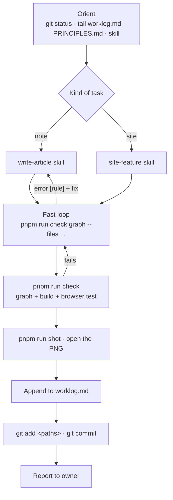

# Workflow

How work moves through this repo, for the owner and for agents. Rules live in `AGENTS.md`, reasons in `PRINCIPLES.md`, the plan for visuals in `docs/visual-system.md`.

## Who does what

| Owner | Agent | System |
| --- | --- | --- |
| Picks topics, reviews notes, promotes status past `draft`, edits `PRINCIPLES.md` | Gathers sources, writes facts and prose, draws concept visuals, fixes what checks report | Validates, lays out, colours, derives numbers, compares models, blocks bad commits |

The agent should spend its effort on content. If an agent keeps making the same mistake, the fix is a new check (`docs/guardrails.md#adding-a-rule`), not a longer instruction.

## One task, end to end



## Writing a model (system) note

1. **Facts.** Check `research/` for a fact sheet. If none, write `research/<family>-facts.md`: every number with source id and section or config key.
2. **Sources.** One YAML per source in `src/content/sources/`.
3. **Model data.** Write `src/content/models/<slug>.yaml` with keys from `src/lib/models/fields.mjs`; `extends` the parent model and state only what you sourced; every value is `{ v, source, where }` (add `display` when the source writes it differently, e.g. `128K`). Layer patterns use sublayer codes (`AD*3 AE*58`, `CD*2 AD ...`); the check verifies the count against `layers`. Show it in the note with `<ModelSpec model="<slug>" />`, and `<ModelSpec model="<slug>" diff />` for what changed from the parent.
4. **Stubs.** `pnpm run new concept <slug> "Title"` for each missing concept, with a real summary.
5. **Note.** `pnpm run new system <slug> "Title" --draft`. Put the model card first, then one section per thing that is new, each with its visual before its prose. Link everything reused.
6. **Fast check** after each edit: `pnpm run check:graph --files <your files>`.
7. Finish with `.agents/skills/finish-task/SKILL.md`.

## Writing a concept note

Same as above without model data. Plan two to four visuals before writing (`<ArchDiagram>` structure, `<Calc>` scaling, `<Stepper>` procedure), then write the prose around them. Don't put numbers in diagram labels; cite them in prose or a `<Spec>`.

## Comparing models

- In a note: `<Compare models={["deepseek-v3", "nemotron-3-super"]} />`.
- Ad hoc: `/compare/?m=deepseek-v3,nemotron-3-super`.
- A field missing from a model shows as "not reported" rather than a guess.
- Derived rows (head dim, attention layers, KV cache per token and at full context, active share) are computed in `src/lib/models/data.mjs` from sourced values; hover shows the formula. Never type a derived number by hand.

## Keeping costs down

Agent context is the expensive part. Defaults:

- **Worklog:** `tail -n 40 worklog.md` only. Never open the whole file. Newest entries are at the bottom; read upward and stop once you have the context you need. To find an older topic: `grep -n "<term>" worklog.md | tail -n 5`, then `sed -n '<from>,<to>p' worklog.md`.
- **Large files:** read by line range (`sed -n`, or Read with offset/limit), not whole.
- **Checks:** iterate with `check:graph --files ...` (under a second); run the full `pnpm run check` once at the end.
- **Search before reading:** `rg -l "<term>" src/content/notes` to find the note, then read only that note.
- **Fact sheets** in `research/` exist so the next agent doesn't redo the web search. Write one for any topic that took real searching.
- **Screenshots:** one `--full` shot per changed note, plus `--width 390` only when layout changed.

## The worklog

`worklog.md` is an append-only log at the repo root, one entry per finished task, newest at the bottom. It's how the next agent learns what just happened without reading git history or the whole file.

Append with the shell, right before committing (works in bash and fish), and stage it with your other files:

```sh
printf '\n## %s · %s\n- did: %s\n- files: %s\n- open: %s\n' \
  "$(date +%F)" "content(rope): write draft with rotation stepper" \
  "what changed, one line" "main files or globs" "unverified numbers, follow-ups, or none" >> worklog.md
```

- The heading carries the date and the commit subject, so `git log --grep "<subject>"` finds the commit.
- Keep entries to these three bullets. Detail belongs in the commit and the notes.
- Never edit or reorder old entries. Appending only keeps concurrent agents from conflicting.
